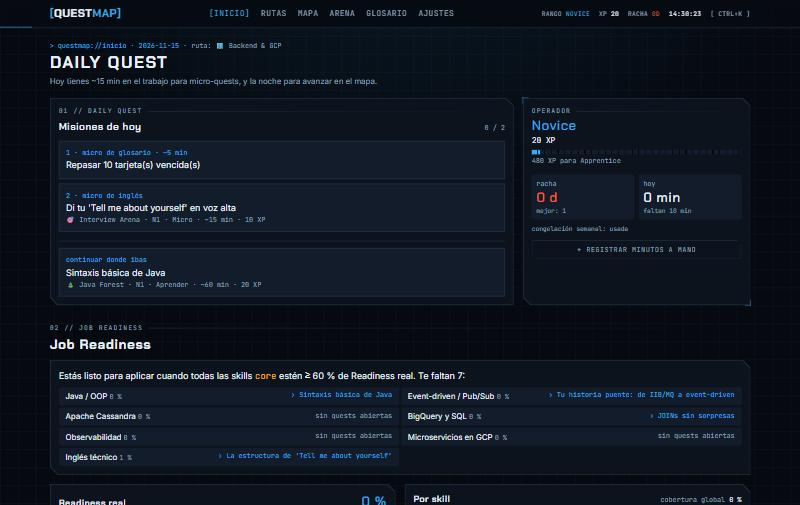
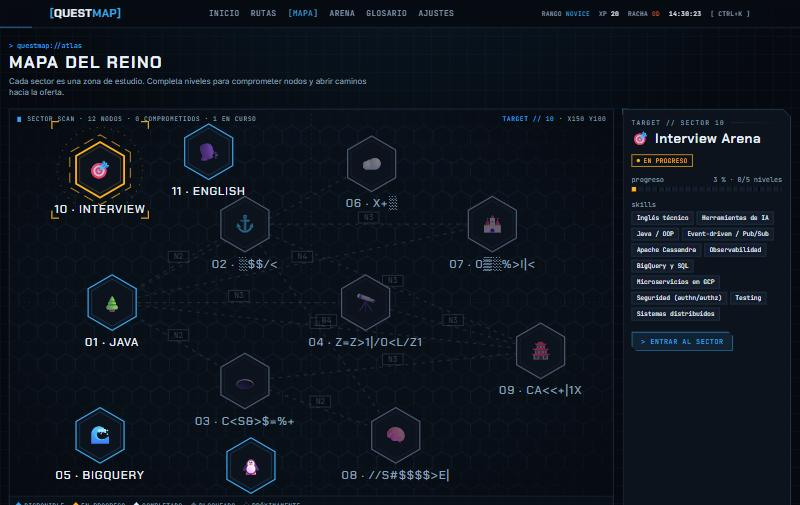
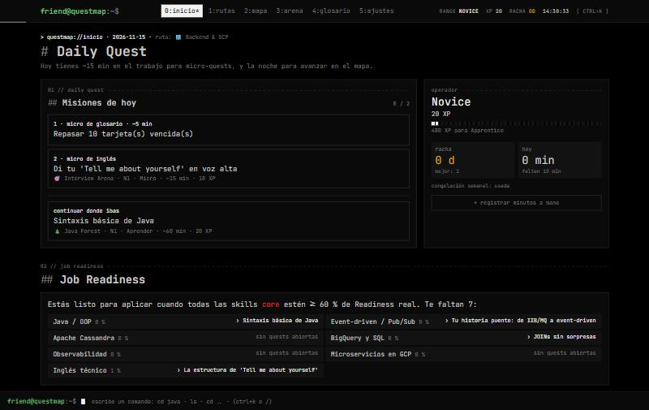
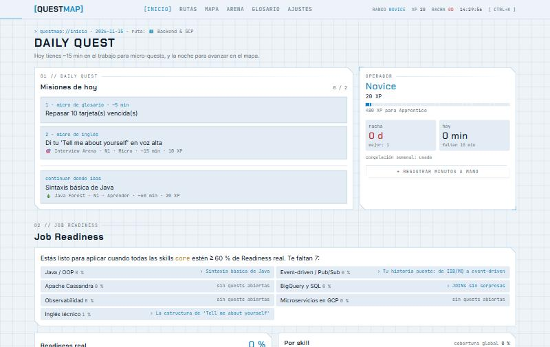
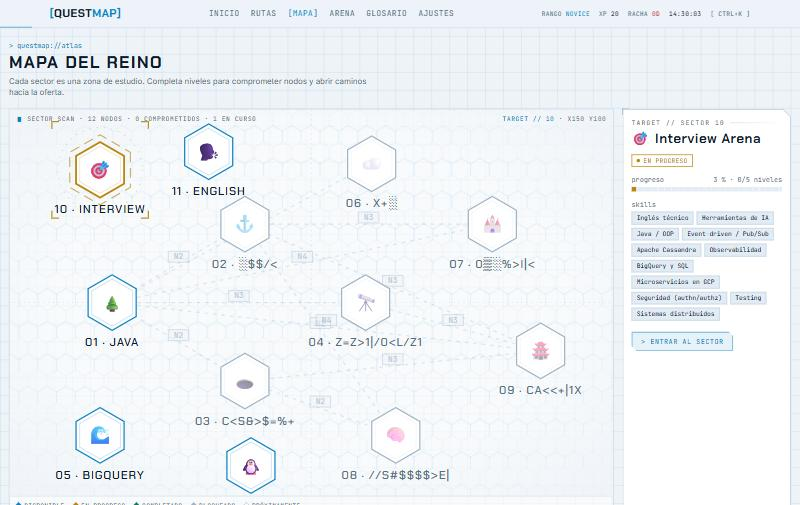
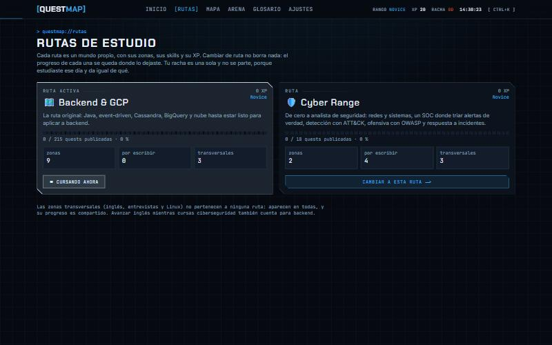

# QuestMap

Convierte estudiar en un **mapa de videojuego**: una app web local (Docker + Next.js + Postgres) de un solo usuario, donde cada zona del mapa enseña, practica y evalúa lo que necesitas para una meta concreta — una oferta de trabajo o una lista de skills.

Piénsalo como un gimnasio en casa: la máquina (la app) es siempre la misma; lo que cambia es el **plan de entrenamiento** que le cargas. Ese plan es un archivo de texto.



En este repo hay **dos cosas**:

| Qué | Dónde | Para qué |
|---|---|---|
| **La plantilla genérica** | [`docs/PLANTILLA-QUESTMAP.md`](docs/PLANTILLA-QUESTMAP.md) | El spec reutilizable. Rellenas un brief de ~40 líneas y Claude Code te construye *tu* QuestMap desde cero. |
| **Este proyecto, como ejemplo** | todo lo demás (`src/`, `content/`, [`SPEC.md`](SPEC.md)) | Una instancia ya construida y funcionando, para ver a qué se parece el resultado antes de hacer el tuyo. |

> **¿Vas a modificar el código, tú o una IA?** Lee primero [`AGENTS.md`](AGENTS.md): requisitos
> técnicos, el ciclo de build (`docker compose up -d` **no** recompila) y las convenciones del repo
> que es fácil reinventar mal. [`CLAUDE.md`](CLAUDE.md) apunta ahí.

---

## Parte 1 — La plantilla: cómo hacer tu propio QuestMap

La plantilla es un `SPEC.md` genérico y ya probado. Tiene **una sola sección que rellenas** (el *Brief*): tu meta, tu experiencia previa, cuánto tiempo tienes al día, tu sistema operativo y el estilo visual que quieres. El resto (mecánicas de juego, modelo de datos, Docker, integración con Claude, fases de implementación, criterios de aceptación) es fijo.

### Antes de empezar, instala esto

| Dependencia | Para qué | ¿Obligatoria? | Cómo comprobarla |
|---|---|---|---|
| **Docker Desktop** (con WSL2 en Windows) | Corre la app y la base de datos | Sí — y debe estar **abierto** | `docker --version` y `docker compose version` |
| **Git** | Historial, commits por fase | Sí | `git --version` |
| **Node.js LTS** (incluye npm) | Comandos de contenido y pruebas desde tu PC | Sí | `node --version` |
| **Claude Code** | Es quien construye todo | Sí | `claude --version` |
| API key de Anthropic con créditos | Calificación dentro de la app (Modo B) | No — sin ella todo funciona copiando/pegando | — |
| Tailscale | Abrir la app desde el celular | Solo si usarás celular | `tailscale status` |

Los **labs** de cada zona pueden pedir algo más (un JDK, una CLI, una cuenta gratuita). Eso depende de tu currículo: Claude Code lo lista en una tabla "Herramientas por zona" al final de la Fase 0, antes de escribir código.

### Los cuatro pasos

1. Crea una carpeta vacía y copia la plantilla dentro **con el nombre `SPEC.md`**:

```powershell
mkdir mi-questmap; Copy-Item docs\PLANTILLA-QUESTMAP.md mi-questmap\SPEC.md
```

2. Abre `mi-questmap\SPEC.md` y rellena **solo la sección 0 (Brief)**. Si tu meta es una oferta de trabajo, pega el **texto completo** de la oferta, no solo la URL (las URLs caducan).

3. Abre Claude Code en esa carpeta y pídele:

```
Lee SPEC.md completo y empieza por la Fase 0. Después de que apruebe el currículo, construye las fases en orden sin preguntarme detalles menores.
```

4. Hay **un único punto de parada**: al final de la Fase 0, Claude Code te presenta un `CURRICULUM.md` (skills, zonas, prerrequisitos, qué enseña cada nivel) y espera tu aprobación. A partir de ahí construye solo, con un commit por fase.

La app mínima usable sale en las fases 1–4; el contenido de las zonas se escribe después, poco a poco, con `npm run content:new` / `content:apply`.

---

## Parte 2 — Este ejemplo

**Meta:** prepararse para una oferta de *Software Engineer, Backend & Distributed Systems* en Home Depot. El brief relleno y el currículo aprobado están en [`SPEC.md`](SPEC.md).

Lo que salió de ese brief, más lo que se ha añadido después:

- **2 rutas de estudio**: *Backend & GCP* (la original, salida de la oferta) y *Cyber Range*, una ruta de ciberseguridad desde cero. Cada una lleva su propio XP, su propio rango y su propio "¿estoy listo para aplicar?". Ver [Rutas de estudio](#rutas-de-estudio).
- **22 skills**: las 15 de Backend & GCP más 7 de ciberseguridad. Tres son **transversales** (`english`, `linux`, `ai_tools`) y cuentan en todas las rutas.
- **18 zonas** en el mapa, con grafo de prerrequisitos. Nueve de backend (Java Forest, Event Harbor, Cassandra Caverns, Observability Observatory, BigQuery Bay, GCP Peaks, Security Fortress, Distributed Systems Citadel, Capstone Castle), seis de ciberseguridad (Bastion Gate, Blue Harbor, Threat Ridge, Red Hollow, Incident Keep, Cloud Bastion) y tres **transversales** que aparecen en ambas rutas: Interview Arena, English Track y Terminal Tundra.
- **354 quests** repartidas en los niveles de cada zona: `learn` (lecciones), `glossary`, `lab` (ejercicios en tu máquina), `quiz`, `micro` (sesiones de 15 min), `open_answer`, `interview` y un `boss` que cierra las zonas que ya están completas.
- **384 términos** de glosario (definición en español, el término en inglés, ejemplo y una analogía cotidiana) y **162 recursos** de estudio.

La zona 12, **Terminal Tundra** 🐧, no sale de la oferta: se agregó el 2026-11-07 al notar que todos los labs de las demás zonas entran a un Linux (`docker exec`) que nunca se enseñaba. Enseña terminal, permisos, triage de logs, procesos y señales, el Linux de los contenedores y de GKE, y bash para CI. Arranca desbloqueada, no es prerrequisito de nada y su skill `linux` no es core, para no tapar las recomendaciones de Java y Cassandra.
- Tema visual **Neon Atlas / ctOS** (inspirado en Watch Dogs): paneles angulares con esquinas cortadas y marcas de "profiler", barra HUD con rango, XP, racha y reloj, mapa con retícula de objetivo y flujo de datos en los caminos abiertos, pantalla de arranque una vez al día y una **terminal de comandos** (`Ctrl+K` o `/`) para saltar a cualquier página o sector escribiendo su nombre. Los sectores bloqueados se ven como "datos cifrados" (también en la terminal) y se descifran al cumplir sus requisitos. En **Ajustes → Efectos** eliges la **interfaz** (*HUD* estilo Watch Dogs, o *Terminal* estilo Mr. Robot: todo en fuente mono, el mapa como un escaneo `nmap`, barras ASCII, arranque por `ssh` y una barra de comandos fija que entiende `cd java`, `ls` o `cd ..`) y la **paleta**, independiente de la interfaz: **ctOS** (azul acero y ámbar, la predeterminada), **Neon Atlas** (cian y magenta), **DedSec** (amarillo ácido y rosa), **fsociety** (gris y blanco con un solo rojo), **Frostpunk** (naranja de brasa contra acero helado), **Cyberpunk** (amarillo señal y cian sobre negro con tinte sangre) o **Animus** (Assassin's Creed: la sala blanca, la única paleta clara). Ahí también apagas las animaciones o el efecto CRT. Cada ruta trae una paleta por defecto que se aplica al activarla, pero lo que elijas a mano en Ajustes manda.

**Stack:** Next.js 15 + React 19 (App Router, Server Actions), Postgres 16 con Drizzle ORM, Tailwind 4, todo en Docker Compose. Contenido en YAML validado con Zod. Pruebas de lógica con `node:test`.

Si solo quieres ver el resultado, clona, arranca y recorre el mapa — el contenido ya está escrito.

---

## Requisitos para correr este ejemplo

- Windows + Docker Desktop (WSL2) + PowerShell 7.
- Recomendado: clonar el repo dentro del sistema de archivos de WSL2 (más rápido).

## Arrancar

```powershell
Copy-Item .env.example .env
docker compose up -d --build
```

Abre http://127.0.0.1:3000. Al arrancar, la app corre las migraciones y el seed automáticamente.

Revisa en `.env` que `TZ` sea tu zona horaria (`America/New_York` para Atlanta): de ella depende qué cuenta como "hoy" en la racha.

---

## Cómo se usa el sistema

### El día a día: la portada

Abre `/` y tienes **las misiones de hoy**, con un contador `hechas / totales`:

1. **Micro de glosario** (~5 min) — repasa las tarjetas vencidas del SRS. Si no hay vencidas, te ofrece términos nuevos.
2. **Micro de inglés** (~15 min) — una quest corta del English Track o del Arena.

Cuando cumples una, queda tachada con su enlace vivo por si quieres seguir, y el contador avanza. Debajo, separado por una línea, está **"continuar donde ibas"**: la siguiente quest abierta del mapa. No es una misión diaria — es el puntero a tu campaña, para que no tengas que ir a buscarlo.

A la derecha ves tu rango, el XP, la racha y los minutos de hoy, y más abajo el **Job Readiness**: una barra por skill con dos métricas que nunca se mezclan — *cobertura* (cuánto del contenido publicado llevas) y *readiness real* (cuánto del objetivo de la skill, donde lo que está en `outline` cuenta 0).

### El mapa



`/mapa` es el grafo de zonas de tu ruta activa. Cada hexágono es un sector; los que no has desbloqueado aparecen **cifrados** y se descifran al cumplir sus prerrequisitos. Clic en una zona para ver sus niveles, y en un nivel para ver sus quests.

Una zona se abre cuando completas el nivel que exige su prerrequisito. Completar quests `required` sube de nivel; las opcionales dan XP pero no bloquean.

### Tipos de quest

| Tipo | Qué haces |
|---|---|
| `learn` | Lees el resumen y escribes una nota con tus palabras |
| `glossary` | Repasas un grupo de términos y entran al SRS |
| `lab` | Haces un ejercicio en tu máquina y pegas la evidencia |
| `quiz` | Preguntas de opción múltiple, verdadero/falso u ordenar |
| `open_answer` | Escribes una respuesta larga que Claude califica con una rúbrica |
| `interview` | Simulación de entrevista en el Arena |
| `micro` | Sesión corta de 10–15 min, pensada para huecos del día |
| `boss` | El examen de la zona |

### Glosario y repaso espaciado

`/glosario` lista los términos **de tu ruta activa** (los transversales siempre entran). `/glosario/repaso` es la sesión de tarjetas: cada respuesta ajusta el intervalo con un algoritmo de repetición espaciada, así que las que fallas vuelven pronto y las que dominas se espacian. Es el mecanismo que más retención te da del sistema; la micro diaria existe para que no lo saltes.

### Arena

`/arena` son simulaciones de entrevista: conductuales, técnicas por zona, system design y take-home. Escribes o dictas tu respuesta y recibes una evaluación con rúbrica.

### Racha y minutos

La racha cuenta **días con minutos registrados**, según la zona horaria de `.env`. Es **una sola para todo el sistema**: no se parte por ruta, porque estudiaste ese día y da igual de qué. Puedes registrar minutos a mano desde la portada.

### Ajustes

`/ajustes` tiene tres cosas: **Respaldo** (exportar/importar progreso, reiniciar una zona), **Efectos** (interfaz HUD o Terminal, paleta, animaciones, CRT, sonidos) y el estado de la API de Claude.

### Interfaces y paletas

Son dos cosas **independientes**: la *interfaz* cambia la estructura y el *tema* cambia solo los colores. Cualquier paleta funciona con cualquier interfaz. Cada ruta trae su combinación por defecto y la aplica al activarse, pero lo que elijas a mano aquí manda.

Hay tres interfaces, y cada una **dibuja el mapa a su manera**:

- **HUD · Watch Dogs** — paneles angulares y el mapa como una retícula de hexágonos.
- **Terminal · Mr. Robot** — todo es una shell: fuente mono, encabezados como comentarios de Markdown, el mapa como un escaneo `nmap`, barras ASCII y una barra de comandos fija abajo que entiende `cd java`, `ls` o `cd ..`.
- **Consola Retro · BIOS** — una máquina de los 80: mayúsculas, cajas de 2 px y el mapa como un POST que detecta cada zona como si fuera un dispositivo (`READY`, `ACTIVE`, `PASSED`, `LOCKED`).



De las siete paletas, **Animus** (Assassin's Creed) es la única clara: la sala blanca con su retícula azul, azul Animus para lo que puedes revivir, oro para la memoria en curso y rojo de desincronización.



En el mapa es donde más se nota el cambio de aire:



---

## Rutas de estudio

Una **ruta** es un mundo propio: sus zonas, sus skills, su XP y su readiness. Sirve para estudiar
temas distintos sin que se mezclen — si hoy avanzas backend y mañana ciberseguridad, cada una lleva
su cuenta aparte.



Entra a `/rutas` y verás una tarjeta por ruta con su XP, su rango y su avance. El botón **"cambiar a
esta ruta →"** la activa:

- El mapa, la portada, el readiness y el glosario pasan a ser los de esa ruta.
- Se aplica **el aspecto de la ruta**: su paleta y su interfaz. Backend & GCP entra en HUD + ctOS, con el mapa de hexágonos; Cyber Range entra en Terminal + fsociety, con el mapa como escaneo `nmap`. Las dos cosas son valores por defecto: si luego las cambias a mano en Ajustes, tu elección se queda.
- **No se borra nada.** Cambiar de ruta solo mueve un puntero: el progreso de la otra se queda intacto y vuelve tal cual al regresar.

### Zonas transversales

Interview Arena, English Track y Terminal Tundra **no pertenecen a ninguna ruta**: aparecen en todas
y su progreso es compartido. Avanzar inglés mientras cursas ciberseguridad también cuenta para
backend. Lo mismo con las skills `english`, `linux` y `ai_tools`.

Es deliberado: el inglés de entrevista y el Linux de base te sirven en cualquier camino, y duplicarlos
habría partido tu baraja de glosario en tres.

### Crear una ruta nueva

1. Añádela a [`content/tracks.yaml`](content/tracks.yaml) con su `slug`, `title`, `emoji`, `palette`, `ui` (`hud` o `terminal`) y `order`.
2. Añade sus skills a `content/skills.yaml` con `track: <slug>`.
3. Crea sus zonas en `content/zones/` con `track: <slug>`. Publica las primeras y deja el resto en `status: outline`.
4. `docker compose up -d --build` y revisa el log del seed.

El campo `track` en una zona o skill admite tres valores: **ausente** (el seed no toca lo que ya haya),
**`null`** (transversal) o un **slug** de ruta.

## Comandos útiles

```powershell
docker compose logs -f app           # ver logs (incluye el resultado del seed)
docker compose down                  # detener (los datos NO se pierden: volumen questmap_pgdata)
docker compose up -d --build         # reconstruir tras cambiar código o contenido
npm test                             # pruebas de la lógica (racha, SRS, XP, quiz, readiness, desbloqueo, parser de Claude)
npm run test:db                      # pruebas de integración con Postgres (seed idempotente, export); requiere docker compose up
```

## Respaldo (no pierdas tu progreso)

Tu progreso vive en el volumen de Docker `questmap_pgdata`: sobrevive a `docker compose down` y a reconstruir. Aun así, haz respaldos:

```powershell
.\scripts\backup.ps1
```

Crea `backups\questmap_AAAAMMDD_HHmm.sql`. Para restaurarlo (reemplaza todo el progreso actual):

```powershell
.\scripts\restore.ps1 backups\questmap_20261105_2130.sql
```

Segunda red de seguridad: en **Ajustes → Respaldo** puedes **exportar** tu progreso a JSON (guárdalo en OneDrive o Google Drive) e **importarlo** después. El JSON usa slugs, así que sirve aunque la base se recree desde cero. Ahí también puedes **reiniciar una zona** (con confirmación).

Nunca uses `docker compose down -v`: la `-v` borra el volumen con tu progreso.

## Usar QuestMap en dos PCs

**Git mueve el código y el contenido, no tu progreso.** El repo no contiene nada de lo que has completado: eso vive en la base de datos, dentro del volumen de Docker de cada máquina (y `backups/` está en `.gitignore`). Son dos cosas separadas, como un libro de texto y tu cuaderno de apuntes: `git pull` te trae el libro, no el cuaderno.

Así que si estudias en la PC B, `git push` desde B y `git pull` en A **no** traen ese avance: la PC A seguirá mostrando el progreso que tenía.

Para mover el progreso usa el export/import de **Ajustes → Respaldo**:

1. En la PC donde estudiaste: **Ajustes → Respaldo → Exportar** → guarda el JSON.
2. Llévalo a la otra PC (OneDrive, Google Drive, una memoria USB).
3. Allí: **Ajustes → Respaldo → Importar** y elige ese archivo.

El JSON identifica todo por `slug`, así que funciona aunque las dos máquinas tengan la base recreada desde cero o versiones distintas del contenido.

Reglas para no perder nada:

- **Estudia en una PC a la vez** y exporta al terminar. Importar sobrescribe el progreso de la máquina destino: si avanzas en las dos a la vez, el último import gana y pierdes lo de la otra.
- Si vas a cambiar de máquina, el orden es: exportar en la PC donde estudiaste → `git push` (si tocaste código o contenido) → en la otra PC `git pull` → `docker compose up -d --build` → importar el JSON.
- Si prefieres que el progreso también viaje por git, exporta el JSON a una carpeta versionada (por ejemplo `progress/`) y haz commit a mano. Es un paso manual deliberado, no automático; recuerda que ese archivo contiene tus respuestas y notas.

## Claude (calificaciones y entrevistas)

- **Modo A (por defecto, $0):** la app genera un prompt; lo pegas en claude.ai y pegas la respuesta de vuelta.
- **Modo B (API):** pon tu clave en `.env` y reconstruye. Todo ocurre dentro de la app; la clave nunca llega al navegador.

```powershell
notepad .env   # ANTHROPIC_API_KEY=sk-ant-...   CLAUDE_MODEL=claude-sonnet-5-5   MAX_API_CALLS_PER_DAY=50
```

```powershell
docker compose up -d --build
```

En **Ajustes** ves si la API está activa, las llamadas de hoy contra el tope y los tokens aproximados por sesión. Si la API falla o llegas al tope, la app cae al Modo A sin perder lo que escribiste.

## Contenido

Todo vive en `content/` (YAML):

| Carpeta | Qué hay |
|---|---|
| `tracks.yaml` | Las rutas de estudio: `slug`, título, emoji, y el aspecto por defecto (`palette` e `ui`) |
| `skills.yaml` | Las 22 skills con su `target_xp` (y el cálculo comentado) y su `track` |
| `resources.yaml` | Recursos de estudio. Solo `verified: true` si la URL se abrió; si no, `url: null` + `how_to_find` |
| `zones/*.yaml` | Zonas → niveles → quests (learn, glossary, lab, quiz, micro, open_answer, interview, boss). El campo `track` decide a qué ruta pertenece |
| `glossary/*.yaml` | Términos con definición en español, en inglés, ejemplo y analogía |
| `interviews/*.yaml` | Plantillas del Interview Arena (conductuales, técnicas por zona, system design, take-home) |

Edita o agrega archivos y reconstruye. El seed valida todo con Zod (si algo está mal, el log dice el archivo y el campo), hace upsert por `slug`, nunca duplica ni borra tu progreso, y lo que quites del YAML queda `archived`.

### Completar las zonas "próximamente" (content:new)

Las zonas 4–9 y los niveles 2–5 del Arena tienen niveles y quests esqueleto. Para escribir un nivel completo:

1. Genera el prompt (queda en `content\_drafts\`):

```powershell
npm run content:new -- --zone observability-observatory --level 1
```

2. Dáselo a Claude: pégalo en claude.ai (o pídeselo a Claude Code) y guarda el bloque YAML de la respuesta como `content\_drafts\observability-observatory-1.yaml`. Con la API configurada puedes saltarte este paso con `--api`.
3. Valídalo e intégralo (si algo falla, no se escribe nada):

```powershell
npm run content:apply -- --file content\_drafts\observability-observatory-1.yaml
```

4. Reconstruye: `docker compose up -d --build`. Revisa el log del seed: si avisa que un `target_xp` se aleja más de 15 % del contenido real, ajústalo en `skills.yaml`.

Para validar sin escribir agrega `--dry-run`.

## Efectos

En **Ajustes → Efectos** puedes apagar las animaciones (glitch al ganar XP, línea de escaneo del mapa, texto que se descifra) y activar los sonidos (apagados por defecto). Los sectores bloqueados del mapa aparecen como "datos cifrados" y se van descifrando a medida que cumples sus requisitos.

## Acceso desde otro dispositivo (opcional, Tailscale)

La app solo escucha en `127.0.0.1`. Si algún día quieres abrirla desde el celular o desde otra PC fuera de casa, usa Tailscale (gratis) **sin** abrir puertos:

1. Instala Tailscale en esta PC y en el otro dispositivo, e inicia sesión con la misma cuenta.
2. En el panel de Tailscale (DNS) activa **MagicDNS** y **HTTPS Certificates**.
3. En PowerShell, en esta PC:

```powershell
tailscale serve --bg 3000
```

4. Abre `https://<nombre-de-tu-pc>.<tu-tailnet>.ts.net` desde el otro dispositivo.

Para ver el estado o apagarlo:

```powershell
tailscale serve status
```

```powershell
tailscale serve --https=443 off
```

Reglas de seguridad: nunca publiques el puerto en `0.0.0.0`, nunca uses port forwarding en el router y nunca uses `tailscale funnel` (eso sí lo expondría a internet). Limitación: la PC debe estar encendida y Docker corriendo.

> Nota: este es un proyecto personal de estudio. "Home Depot" aparece solo como la meta de este ejemplo; el repo no tiene relación con esa empresa ni contiene material suyo.
